# Athletix — Phase G: Security and Reliability Audit Report

**Date & Time**: 2026-10-11T21:45:00+05:30  
**Environment**: Production Docker Stack on Windows (Docker Engine 28.0.0, Python 3.11.9, Vite 5.4.21, MongoDB 7.0.43)  
**Project Path**: `C:\Users\janap\Desktop\Athletix`  
**Overall Audit Status**: **PASS WITH LIMITATIONS**

---

## 1. Executive Summary & Audit Scope

This document provides the formal security, authorization, data integrity, and reliability audit of the Athletix SportsTech platform in accordance with the Phase G specifications. The audit evaluates the platform's posture following the completion of Phases A–F2, with special focus on credential handling, token lifecycle gating, multi-persona RBAC boundaries, single-academy data isolation, input validation, and deployment surface hardening.

### Audit Objectives
1. **Evidence-Based Assessment**: Verify security controls and vulnerabilities through code inspection, static analysis, and reproducible automated tests rather than assumptions.
2. **Data Safety Guarantee**: Preserve all existing MongoDB records, seed accounts (`admin@athletix.dev`, `coach1@athletix.dev`, `athlete1@athletix.dev`, `jana@gmail.com`, `ananthika@gmail.com`), and volume states without drops or resets.
3. **Targeted Remediation**: Address confirmed security gaps cleanly without refactoring working features or breaking backward compatibility.
4. **Architecture Clarification**: Document multi-tenancy and data isolation boundaries without silently altering application scope.

---

## 2. Authentication & Sessions Audit

| Security Control | Implementation Detail | Audit Finding | Status |
|---|---|---|---|
| **Password Storage** | Passwords hashed using `bcrypt.hashpw` with unique cryptographic salt (`backend/app/core/security.py`). Minimum length 8 characters enforced by Pydantic schemas. | Passwords never stored in plaintext. Response schemas (`UserResponse.from_doc`) strictly strip `hashed_password`. | **PASS** |
| **JWT Secrets & Algorithms** | Secret key loaded dynamically via `pydantic-settings` from environment variable `JWT_SECRET` (`backend/app/core/config.py`). Algorithm set to HMAC-SHA256 (`HS256`). | Secret is not hardcoded in application logic. Production deployments must provide high-entropy secret. | **PASS** |
| **Token Expiration** | Token lifetime configured via `ACCESS_TOKEN_EXPIRE_MINUTES` (default 60 minutes) with explicit `exp` claim verification in `jose.jwt.decode`. | Tokens strictly expire after configured delta. Expired tokens rejected with HTTP 401 Unauthorized. | **PASS** |
| **Inactive / Pending User Token Gating** | User identity resolved in `get_current_user` (`backend/app/core/dependencies.py`). | **Vulnerability Found & Remediated**: Stale JWTs for deactivated/pending users previously bypassed database status checks. Remediated by querying MongoDB in `get_current_user`. | **PASS (Remediated)** |
| **Timing Attack Mitigation (Login)** | `login_user` in `backend/app/services/auth_service.py`. | **Gap Found & Remediated**: Unknown email previously skipped bcrypt check (<1ms vs ~200ms). Remediated with dummy bcrypt verification. | **PASS (Remediated)** |
| **Secret Scrubbing & Logging** | Python logging in `backend/app/` (`logging.getLogger`). | Zero sensitive credentials, passwords, or tokens printed in application logs or exception traces. | **PASS** |
| **Session Invalidation / Logout** | Stateless JWT architecture with client-side token discarding and server acknowledgment endpoint `POST /api/v1/auth/logout`. | Complies with standard stateless JWT specification. | **PASS** |

---

## 3. Role-Based Access Control (RBAC) Audit

API access control was tested and audited at the FastAPI router dependency layer across all 3 personas:

```mermaid
graph TD
    Client[Client Request] --> BearerAuth[HTTPBearer Token Validation]
    BearerAuth --> DBCheck[MongoDB Live User Active Check]
    DBCheck --> RoleRouter{Route Role Dependency}
    RoleRouter -->|require_admin| AdminOnly[Admin Only: /users, /sports, /coaches/status]
    RoleRouter -->|require_coach| CoachAdmin[Coach & Admin: /training, /assessments]
    RoleRouter -->|get_current_user| Ownership[Self / Assigned Ownership Check: /athletes/me, /notifications]
```



### 3.1 Persona Boundary Enforcement
- **Athlete Boundary**:
  - Direct access to `/api/v1/users` (Admin user management) returns **HTTP 403 Forbidden**.
  - Direct access to `/api/v1/coaches/me` returns **HTTP 404/403**.
  - Direct attempt to create training sessions (`POST /api/v1/training/sessions`) returns **HTTP 403 Forbidden**.
  - Direct attempt to create performance assessments (`POST /api/v1/assessments`) returns **HTTP 403 Forbidden**.
  - Direct attempt to record tournament results (`POST /api/v1/tournaments/{id}/results`) returns **HTTP 403 Forbidden**.
  - Athlete self-update (`PUT /api/v1/athletes/{id}`) allows only contact fields (`phone`, `address`, `emergency_contact`); fields like `status`, `sport_id`, `coach_id` are strictly ignored.
- **Coach Boundary**:
  - Access to `/api/v1/users` returns **HTTP 403 Forbidden**.
  - Access to admin sport creation (`POST /api/v1/sports`) returns **HTTP 403 Forbidden**.
  - Access to coach status modification (`PATCH /api/v1/coaches/{id}/status`) returns **HTTP 403 Forbidden**.
  - Coach can only assess or schedule training for **assigned athletes** (`coach_athlete_assignments` or direct `coach_id`); assessing unassigned athletes returns **HTTP 403 Forbidden**.
- **Admin Boundary**:
  - Full management of all academy records, users, sports, tournaments, and assignments.
  - Creation of new Admin accounts is restricted to authorized Admins via `POST /api/v1/users` (Approach C); public registration cannot self-assign Admin privileges.

---

## 4. Academy Data Isolation & Architecture Analysis

### 4.1 Determination: Single-Academy Architecture
A comprehensive audit of the database collections and models was performed:
- Queried all collections: `users`, `athletes`, `coaches`, `sports`, `training_sessions`, `attendance`, `performance_assessments`, `tournaments`, `tournament_participants`, `notifications`.
- Scanned for tenant identifiers (`academy_id`, `tenant_id`, `organization_id`). Zero tenant keys exist in any collection or schema.
- **Conclusion**: Athletix is engineered as a **Single-Academy Platform**. All users, athletes, coaches, and tournaments belong to one consolidated academy institution.

### 4.2 Deployment Limitation Notice
> [!WARNING]
> **Deployment Limitation**: The application does NOT support multi-tenant isolation out of the box. Running multiple independent sports academies within the same database instance is unsupported and would lead to shared access to rankings, tournaments, and rosters.
> 
> **Safe Deployment Strategy**: Each sports academy must be deployed as an independent container stack with its own dedicated MongoDB database instance.

### 4.3 Proposed Future Multi-Tenant Roadmap
If multi-academy hosting is required in future releases, the following non-breaking architecture is recommended:
1. **Tenant Domain Model**: Introduce an `academies` collection (`_id`, `name`, `code`, `subscription_status`, `created_at`).
2. **Compound Keys**: Add indexed `academy_id: ObjectId` across `users`, `athletes`, `coaches`, `sports`, `tournaments`, `training_sessions`.
3. **Context Dependency**: Extract `academy_id` from JWT claims and inject as a mandatory query filter in base repository find queries.
4. **Unique Index Scoping**: Update unique indexes (e.g. `{"academy_id": 1, "email": 1}`).

---

## 5. Input Validation, ObjectIds & API Safety

| Area | Implementation & Audit Result | Status |
|---|---|---|
| **Malformed ObjectIds** | All repository query methods (`get_user_by_id`, `get_athlete_by_id`, `get_tournament_by_id`, `get_session_by_id`, `get_assessment_by_id`) catch `Exception` / `InvalidId` and return `None`, yielding clean **HTTP 404 Not Found** or **HTTP 400 Bad Request** instead of unhandled 500 crashes. | **PASS** |
| **Field Validation** | Pydantic v2 schemas (`BaseModel`, `Field`, `model_validator`) validate and sanitize all payload fields. Extraneous fields are ignored (`extra="ignore"`), and malformed structures return HTTP 422 Unprocessable Entity. | **PASS** |
| **Metric & Score Ranges** | `AssessmentCreate` enforces numeric metric values bounded strictly between `0.0` and `100.0`. `overall_score` bounded strictly between `0.0` and `100.0`. Out-of-bounds scores trigger HTTP 422 validation errors. | **PASS** |
| **Attendance Statuses** | `AttendanceRecordCreate` canonicalizes and restricts status values to `("present", "absent", "late")`. Unrecognized statuses rejected with HTTP 422. | **PASS** |
| **IDOR Prevention** | Notification endpoints (`PATCH /{id}/read`, `DELETE /{id}`) verify that `current_user["user_id"]` matches `recipient_user_id`. Attempting to read or delete another user's notification raises **HTTP 403 Forbidden**. Athlete profiles enforce self-only view/edit checks. | **PASS** |
| **Error Stack Sanitization** | Production error responses return standard JSON structures (`{"detail": "..."}`). Internal Python tracebacks are suppressed from client responses. | **PASS** |

---

## 6. Database & Reliability

### 6.1 MongoDB Connection & Lifespan
- Connection managed cleanly via FastAPI lifespan context (`backend/app/main.py`), initializing `AsyncIOMotorClient` and pinging `admin.command("ping")` on startup, and closing cleanly on shutdown.
- Query operations are fully non-blocking asynchronous coroutines using `motor.motor_asyncio`.

### 6.2 Index Coverage
Indexes are guaranteed on application boot via `create_indexes(db)` (`backend/app/db/indexes.py`):
- `users`: `{"email": 1}` (unique)
- `athletes`: `{"user_id": 1}`, `{"sport_id": 1}`
- `coaches`: `{"user_id": 1}`
- `coach_athlete_assignments`: `{"coach_id": 1, "athlete_id": 1}` (unique)
- `training_sessions`: `{"date": 1}`, `{"session_date": 1}`, `{"coach_id": 1}`, `{"sport_id": 1}`, `{"status": 1}`
- `attendance`: `{"session_id": 1, "athlete_id": 1}` (unique), `{"athlete_id": 1}`
- `performance_assessments`: `{"athlete_id": 1, "date": -1}`
- `tournaments`: `{"start_date": 1}`
- `tournament_participants`: `{"tournament_id": 1, "athlete_id": 1}`
- `notifications`: `{"user_id": 1, "is_read": 1}`, `{"recipient_user_id": 1, "is_read": 1}`, `{"created_at": -1}`

### 6.3 Relational Consistency & Deduplication
- **Attendance**: Unique compound index prevents duplicate attendance records for the same athlete in a session.
- **Tournament Registration**: Unique athlete registration check prevents multiple entries in the same tournament.
- **Notifications**: De-duplication filter in `create_notification` prevents event spam for identical entities.

---

## 7. Frontend and Deployment Hardening

### 7.1 Frontend Route Protection
- Frontend client implements `ProtectedRoute` (`frontend/src/routes/ProtectedRoute.jsx`) validating authentication and persona role.
- Unauthenticated users are redirected to `/login`.
- Authenticated users attempting to visit unauthorized dashboards (e.g. Athlete navigating to `/admin/dashboard`) are redirected to their authorized persona view (`/athlete/dashboard`).

### 7.2 Client-Side Bundle Inspection
- Static audit of `frontend/src/` confirms zero private API keys, backend secrets, or database connection strings are bundled in client assets.
- Production build runs cleanly through Vite with minified chunks.

### 7.3 CORS & Network Hardening
- CORS origins explicitly restricted in `backend/app/core/config.py`:
  ```python
  CORS_ORIGINS: list[str] = ["http://localhost:5173", "http://localhost:3000", "http://localhost:80"]
  ```
  Wildcard `*` origin with credentials is NOT permitted.

### 7.4 Docker Network & Port Recommendations
- In `docker-compose.yml`, MongoDB currently binds `ports: - "27017:27017"`.
- *Recommendation*: While useful for local debugging, production configurations should bind solely to localhost (`127.0.0.1:27017:27017`) or remove external port exposure entirely, allowing only the internal Docker network (`backend -> mongodb:27017`) to communicate with the database.

---

## 8. Confirmed Vulnerabilities & Implemented Remediations

### Vulnerability 1: Inactive / Pending User Token Gating (SEC-VULN-01)
- **Severity**: Medium-High
- **Affected File**: `backend/app/core/dependencies.py`
- **Description**: Stale JWT tokens issued to users who were subsequently deactivated by an administrator (`is_active = False` or `status = "inactive"`) remained valid on protected endpoints until expiration (up to 60 minutes) because `get_current_user` did not query database user state.
- **Remediation**:
  Updated `get_current_user` to query `db.users.find_one({"_id": user_oid})` and reject requests with HTTP 401 Unauthorized if the user does not exist or has inactive/pending status:
  ```python
  if not user.get("is_active", True) or user.get("status") in [
      "inactive",
      "pending_approval",
      "suspended",
      "rejected",
  ]:
      raise UnauthorizedError("Account is inactive or pending approval")
  ```

### Vulnerability 2: Account Enumeration via Bcrypt Timing Discrepancy (SEC-VULN-02)
- **Severity**: Low-Medium
- **Affected File**: `backend/app/services/auth_service.py`
- **Description**: During `login_user`, non-existent email addresses returned immediately (<1ms) because password verification was short-circuited, whereas registered email addresses executed `verify_password` (~150-300ms). An attacker could measure latency to enumerate registered accounts.
- **Remediation**:
  Introduced precomputed dummy hash verification on non-existent accounts so both existing and non-existing accounts consume equal bcrypt verification latency:
  ```python
  if user is None:
      verify_password(password, _DUMMY_BCRYPT_HASH)
      raise UnauthorizedError("Invalid email or password")
  ```

---

## 9. Automated Test Verification Results

### 9.1 Regression & Security Tests
Six new targeted security regression tests were added to `backend/tests/test_auth.py`:
1. `test_inactive_user_token_blocked_from_protected_apis`: **PASSED**
2. `test_dynamically_deactivated_user_token_immediately_revoked`: **PASSED**
3. `test_pending_approval_user_token_blocked`: **PASSED**
4. `test_nonexistent_user_token_rejected`: **PASSED**
5. `test_malformed_user_id_in_token_rejected`: **PASSED**
6. `test_login_invalid_email_timing_mitigation`: **PASSED**

### 9.2 Complete Backend Test Suite
- **Command**: `.\backend\.venv\Scripts\python.exe -m pytest backend/tests`
- **Total Tests Collected**: **216 items**
- **Test Results**: **216 PASSED, 0 FAILED** (100% Pass Rate)
- **Test Modules Verified**:
  - `test_analytics.py`: 25 passed
  - `test_assessments.py`: 12 passed
  - `test_athletes.py`: 7 passed
  - `test_auth.py`: 23 passed (including 6 new security tests)
  - `test_auth_flow.py`: 11 passed
  - `test_coach_notifications.py`: 11 passed
  - `test_coaches.py`: 5 passed
  - `test_health.py`: 2 passed
  - `test_notifications.py`: 18 passed
  - `test_phase8_workflow.py`: 4 passed
  - `test_rankings.py`: 12 passed
  - `test_registration.py`: 10 passed
  - `test_reports.py`: 16 passed
  - `test_sports.py`: 8 passed
  - `test_tournaments.py`: 29 passed
  - `test_training.py`: 12 passed
  - `test_users.py`: 6 passed
  - `test_zero_participation_rankings.py`: 5 passed

### 9.3 Frontend Production Build
- **Command**: `npm run build --prefix frontend`
- **Result**: **SUCCESS** (`built in 7.47s`, 0 errors, chunks generated cleanly).

---

## 10. Audit Findings & Final Recommendation

| Assessment Dimension | Rating | Summary |
|---|---|---|
| **Authentication & Sessions** | **STRONG** | Passwords hashed with bcrypt; token expiration strictly enforced; inactive and stale token gating active; timing attack mitigated. |
| **Role-Based Access Control** | **STRONG** | Admin, Coach, and Athlete boundaries enforced at route and repository levels with zero IDOR leaks. |
| **Data Safety & Integrity** | **EXCELLENT** | 100% of preexisting MongoDB data and seed accounts preserved; duplicate indexes operational. |
| **Input Validation** | **STRONG** | Malformed ObjectIds handled gracefully without 500 crashes; scores and bounds validated. |
| **Academy Isolation** | **LIMITED** | Single-academy architecture; multi-tenant multi-academy requires separate instances. |
| **Deployment Configuration** | **SATISFACTORY** | CORS restricted; Docker port 27017 exposed to host (requires localhost binding in production). |

### Final Recommendation: **PASS WITH LIMITATIONS**

The Athletix platform successfully passes the Phase G Security and Reliability Audit with full score across authentication, authorization, data integrity, and regression testing. The rating is designated as **PASS WITH LIMITATIONS** exclusively due to the architectural reality that Athletix operates as a single-academy platform and requires separate database instances for independent academies, along with the recommendation to restrict MongoDB host port exposure in production deployments.
